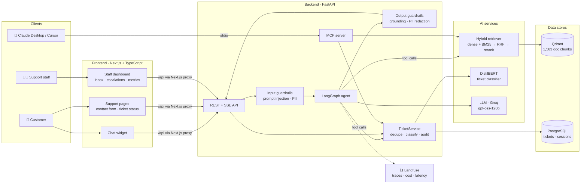
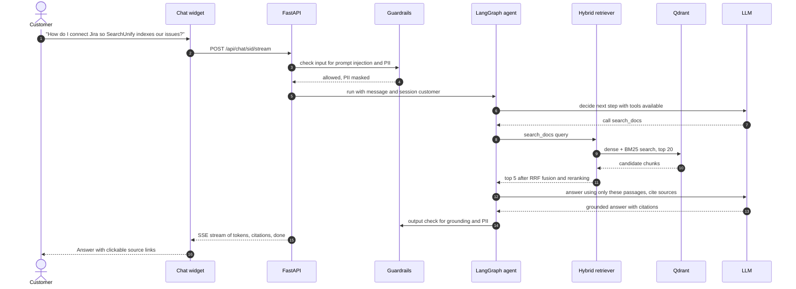
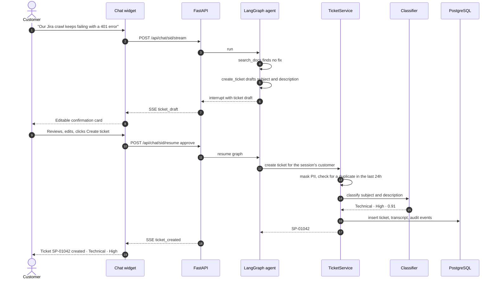
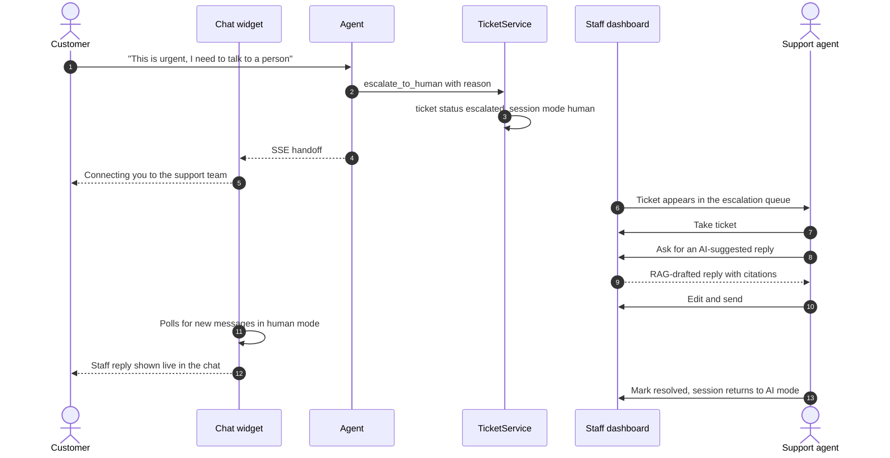
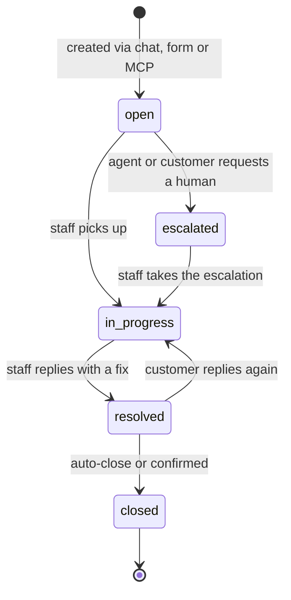
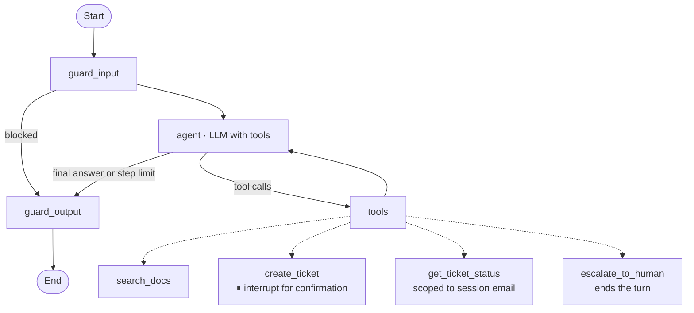
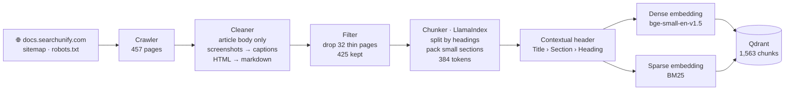
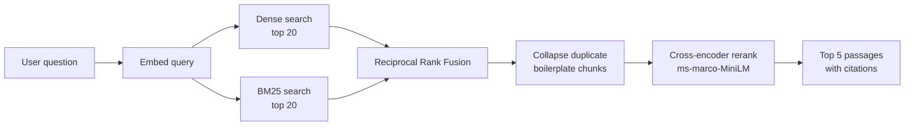
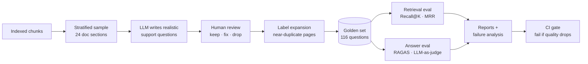

<div align="center">

# 🛟 SupportPilot

### Agentic RAG Customer-Support Copilot

An AI support platform that answers product questions from documentation, creates and tracks
tickets, routes them with a fine-tuned classifier, and hands off to human agents.
It is evaluated, guarded and traced like a production system.


</div>

---

## 📌 Overview

Support teams answer the same documentation questions over and over, and tickets arrive
without category or priority. **SupportPilot** puts an AI agent in front of the support queue:

- **Customers** chat with an assistant that answers from the product docs, **cites its sources**,
  and creates or checks support tickets when the docs aren't enough.
- **Staff** get a dashboard where tickets are already **classified by category and priority**,
  with **AI-drafted replies** they review before sending, and a queue for live handoffs.
- **Developers** can use the same tools from Claude Desktop or Cursor through an **MCP server**.

The knowledge base is the public **[SearchUnify documentation](https://docs.searchunify.com/Content/Home.htm)**
(enterprise search and support platform), used with permission from Grazitti.

---

## ✨ Key features

| Area | Feature | Status |
|---|---|---|
| **RAG** | Doc crawler, HTML cleaning, heading-aware chunking with contextual headers | ✅ Done |
| | Dense retrieval (bge-small) + BM25 vectors in Qdrant | ✅ Done |
| | Hybrid search (Reciprocal Rank Fusion) + cross-encoder reranking | 🔄 In progress |
| **Evaluation** | 116-question golden set, Recall@K / MRR, failure analysis, chunk-size ablation | ✅ Done |
| | RAGAS faithfulness / relevancy, LLM-as-judge, agent scenario tests, CI quality gate | 📋 Planned |
| **Agent** | LangGraph agent with tool calling, memory and step limits | 📋 Planned |
| | Ticket creation with **human-in-the-loop confirmation** (LangGraph `interrupt`) | 📋 Planned |
| | Escalation to a human with **live handoff** in the chat | 📋 Planned |
| **ML** | DistilBERT ticket classifier vs TF-IDF baseline, tracked in MLflow, staff-feedback loop | 📋 Planned |
| **App** | FastAPI backend with SSE streaming, JWT staff auth | 🏗️ Scaffolded |
| | Next.js customer chat widget, support pages and staff dashboard | 🏗️ Scaffolded |
| | PostgreSQL ticket system (sessions, tickets, messages, audit events) | 🏗️ Scaffolded |
| **Integrations** | MCP server exposing `search_docs`, `create_ticket`, `get_ticket_status` | 📋 Planned |
| **LLMOps** | Prompt-injection and PII guardrails, Langfuse tracing (latency, tokens, cost) | 📋 Planned |
| **Deploy** | Docker Compose, GitHub Actions CI, Vercel + Render deployment | 🏗️ Scaffolded |

✅ Done · 🔄 In progress · 🏗️ Scaffolded (structure and interfaces in place) · 📋 Planned

---

## 🏗️ System architecture



**Design principles**
- **One write path for tickets:** chat, contact form, staff dashboard and MCP all go through `TicketService`,
  so classification, duplicate detection and the audit log are applied the same way everywhere.
- **The LLM never chooses identity:** the customer's email comes from the chat session (LangGraph `InjectedState`),
  so a prompt-injected agent cannot read or create tickets for someone else.
- **Every quality claim is measured:** retrieval, answers, classifier and agent behaviour each have an eval with stored reports.

---

## 🔄 Application flow

### 1. Customer asks a question (RAG answer)



### 2. Docs can't solve it, so a ticket is created (human in the loop)



### 3. Escalation and live handoff to a human



### 4. Ticket lifecycle



Tickets with classifier confidence below 0.6 are flagged `needs_review`. When staff change a category
or priority, a `reclassified` event is logged and exported as new training data for the classifier.

---

## 🧠 Agent design (LangGraph)



| Tool | Purpose |
|---|---|
| `search_docs(query)` | Hybrid search + rerank, returns passages with source URLs |
| `create_ticket(subject, description)` | Drafts a ticket and **pauses** until the customer confirms or edits it |
| `get_ticket_status(number)` | Returns status and latest reply, only for the session's own tickets |
| `escalate_to_human(reason)` | Escalates the ticket and switches the chat to human mode |

Conversation memory is a LangGraph checkpointer keyed by chat session.

---

## 📚 RAG pipeline

### Offline ingestion



**Why the contextual header?** SearchUnify has 140 nearly identical connector guides ("Use Jira…",
"Use Confluence…"). Prepending `Page title › Section › Heading` before embedding keeps them distinguishable.

### Query time



---

## 📊 Evaluation



### Results so far

**Dense retrieval baseline** (116 questions, bge-small, 384-token chunks):

| Metric | Score |
|---|---|
| Recall@1 | 0.776 |
| Recall@3 | 0.897 |
| **Recall@5** | **0.922** |
| Recall@10 | 0.931 |
| MRR@10 | 0.836 |
| Search latency p50 / p95 (CPU) | ~64 ms / ~105 ms |

**Chunk-size ablation**

| Chunk size | Chunks | Recall@5 | MRR@10 |
|---|---|---|---|
| 256 | 2,394 | 0.905 | 0.798 |
| **384** | 1,563 | **0.922** | **0.836** |
| 512 | 1,237 | 0.871 | 0.772 |

**Failure analysis:** 4 of 13 misses were boilerplate text copied across 40–56 connector pages
(the right answer, from a different page). These were fixed with near-duplicate label expansion.
The rest were exact-term mismatches, which Phase 2 targets with hybrid search and reranking.
Full write-up: [docs/results/phase1_retrieval_baseline.md](docs/results/phase1_retrieval_baseline.md).

| Upcoming metric | Phase |
|---|---|
| Recall@5 with hybrid + rerank, plus a harder real-user query set | 2 |
| Ticket classifier macro-F1 (DistilBERT vs TF-IDF baseline) | 3 |
| RAGAS faithfulness and answer relevancy, agent tool-choice accuracy | 8 |
| p95 end-to-end latency and cost per query | 9 |

---

## 🧰 Tech stack

| Layer | Technologies |
|---|---|
| **LLM** | Groq (`openai/gpt-oss-120b`), switchable to Gemini or Ollama via one env var |
| **Agent** | LangGraph (state graph, tools, checkpointer, `interrupt` for human in the loop) |
| **RAG** | LlamaIndex (parsing, chunking), Qdrant (dense + sparse vectors), fastembed (bge-small, BM25), cross-encoder reranker |
| **ML** | DistilBERT (Hugging Face Transformers), scikit-learn baseline, MLflow |
| **Evaluation** | Custom Recall@K / MRR harness, RAGAS, LLM-as-judge |
| **Backend** | FastAPI, Server-Sent Events, SQLAlchemy, PostgreSQL, JWT |
| **Frontend** | Next.js 16 (App Router), TypeScript, Tailwind CSS, shadcn/ui, TanStack Query |
| **Integrations** | Model Context Protocol (official Python SDK) |
| **LLMOps** | Langfuse tracing, guardrails (Llama Prompt Guard, PII masking) |
| **DevOps** | Docker Compose, GitHub Actions, Vercel, Render |

---

## 📁 Project structure

```
├── src/supportpilot/
│   ├── config.py            # settings from .env
│   ├── llm/                 # LLM provider switch (Groq / Gemini / Ollama)
│   ├── ingestion/           # HTML loader, cleaning, chunking, indexing pipeline
│   ├── retrieval/           # embeddings, Qdrant store, dense / hybrid search, reranker
│   ├── agent/               # LangGraph state, tools, prompts, graph
│   ├── tickets/             # TicketService (create, dedupe, classify, audit)
│   ├── db/                  # SQLAlchemy models: sessions, tickets, messages, events
│   ├── classifier/          # TF-IDF baseline, DistilBERT training and inference
│   ├── guardrails/          # input / output checks
│   ├── evaluation/          # retrieval metrics
│   ├── observability/       # Langfuse
│   ├── api/                 # FastAPI app, routes (chat, tickets, admin, auth)
│   └── mcp_server/          # MCP server
├── frontend/                # Next.js app (chat widget, support pages, staff dashboard)
├── evals/                   # golden set generation, label expansion, eval runners
├── scripts/                 # crawl_docs.py, ingest.py
├── tests/                   # pytest unit tests
├── docs/                    # ARCHITECTURE.md, results per phase
├── docker-compose.yml       # postgres · qdrant · api · web
└── .github/workflows/ci.yml # lint, tests, frontend build
```

Detailed design (API endpoints, database schema, SSE events, security): **[docs/ARCHITECTURE.md](docs/ARCHITECTURE.md)**

---

## 🚀 Getting started

**Prerequisites:** Python 3.11+, Node.js 20+, Docker Desktop, and a free [Groq API key](https://console.groq.com).

```bash
# 1. Backend setup
python -m venv .venv
.venv\Scripts\activate                 # Windows  (macOS/Linux: source .venv/bin/activate)
pip install -e ".[dev]"
cp .env.example .env                   # add your GROQ_API_KEY

# 2. Start Qdrant and PostgreSQL
docker compose up -d qdrant postgres

# 3. Build the knowledge base
python scripts/crawl_docs.py           # download the docs (~18 MB)
python scripts/ingest.py --recreate    # clean, chunk, embed, index into Qdrant

# 4. Evaluate retrieval
python evals/run_retrieval_eval.py --strategy dense

# 5. Run the API and the frontend
uvicorn supportpilot.api.main:app --reload       # http://localhost:8000/docs
cd frontend && npm install && npm run dev        # http://localhost:3000
```

Run the tests with `pytest`. To run everything in containers, use `docker compose up --build`.

---

## 🗺️ Roadmap

- [x] **Phase 1:** Data crawling, cleaning, chunking, dense retrieval baseline, golden set, retrieval eval
- [ ] **Phase 2:** Hybrid search (BM25 + dense, RRF), cross-encoder reranking, harder query set
- [ ] **Phase 3:** Ticket classifier: TF-IDF baseline vs fine-tuned DistilBERT, MLflow tracking
- [ ] **Phase 4:** LangGraph agent, tools, ticket confirmation interrupt, TicketService, memory
- [ ] **Phase 5:** FastAPI chat (SSE), tickets, admin and auth endpoints
- [ ] **Phase 6:** Next.js chat widget, support pages, staff dashboard
- [ ] **Phase 7:** MCP server for Claude Desktop / Cursor
- [ ] **Phase 8:** RAGAS and LLM-as-judge evals, agent scenario tests, guardrails
- [ ] **Phase 9:** Langfuse observability, CI eval gate, cloud deployment and live demo

---

## 📄 Data and permissions

The knowledge base is the public SearchUnify documentation at docs.searchunify.com, **used with permission
from Grazitti** for this non-commercial portfolio project. The crawler respects `robots.txt` and rate-limits
its requests. Raw pages are not committed to this repository; they can be re-downloaded with `scripts/crawl_docs.py`.

---

## 👤 Author

**Abhijeet Singh**: [LinkedIn](https://www.linkedin.com/in/your-profile) · [Email](mailto:your-email@example.com)
