<div align="center">

# 🛟 SupportPilot

### Agentic RAG Customer-Support Copilot

An AI support platform that answers product questions from documentation, creates and tracks
tickets, routes them with a fine-tuned classifier, and hands off to human agents.
It is evaluated, guarded and traced like a production system.


</div>

---

## 📌 Overview

Support teams answer the same documentation questions over and over, and tickets arrive
without category or priority. **SupportPilot** puts an AI agent in front of the support queue:

- **Customers** chat with an assistant that answers from the product docs, **cites its sources**,
  and creates or checks support tickets when the docs aren't enough.
- **Staff** get a dashboard where tickets are already **classified by category and priority**,
  with **AI-drafted replies** they review before sending, and a queue for live handoffs.
- **Developers** can use the same tools from Claude Desktop or Cursor through an **MCP server**.

The knowledge base is the public **[SearchUnify documentation](https://docs.searchunify.com/Content/Home.htm)**
(enterprise search and support platform), used with permission from Grazitti.

---

## ✨ Key features

| Area | Feature | Status |
|---|---|---|
| **RAG** | Doc crawler, HTML cleaning, heading-aware chunking with contextual headers | ✅ Done |
| | Dense retrieval (bge-small) + BM25 vectors in Qdrant | ✅ Done |
| | Hybrid search (weighted RRF), duplicate collapsing, LLM query rewriting | ✅ Done |
| | Cross-encoder reranking: evaluated, off by default (no recall gain, ~2 s on CPU) | ✅ Done |
| **Evaluation** | Standard + hard (vocabulary-mismatch) test sets, Recall@K / MRR, ablations, failure analysis | ✅ Done |
| | RAGAS faithfulness / relevancy, LLM-as-judge, agent scenario tests, CI quality gate | 📋 Planned |
| **Agent** | LangGraph agent with tool calling, persistent memory (SQLite/Postgres) and step limits | ✅ Done |
| | Ticket creation with **human-in-the-loop confirmation** (LangGraph `interrupt`) | ✅ Done |
| | Escalation to a human with **live handoff** in the same chat (staff replies appear in the widget) | ✅ Done |
| **ML** | DistilBERT ticket classifier (Colab GPU) vs TF-IDF baseline, MLflow, bootstrap CIs, temperature-scaling calibration | ✅ Done |
| **Knowledge loop** | Resolved tickets → LLM-drafted, anonymised KB articles → staff review → indexed with the docs; the assistant answers with them (fix in answers 1/5 → 5/5 on synthetic gap cases) | ✅ Done |
| | Agents link KB articles in replies: suggestions for the ticket, search, one-click insert, usage tracking | ✅ Done |
| **Incidents** | Outage detection from ticket bursts: problem-report gate + similarity + distinct customers + Poisson burst test vs. 7-day baseline (19/20 outages, 0 false on the tuning set; 10/15 → 15/15 held-out); one notice/update for all affected customers; the chat shows the staff notice verbatim | ✅ Done |
| | Doc gaps: every chat question logged with its doc coverage and outcome; uncovered questions clustered into topics (calibrated thresholds) | ✅ Done |
| | Staff-feedback loop (reclassifications → training data) | 📋 Planned |
| **App** | FastAPI backend: 17 endpoints, SSE token streaming, ticket-draft resume, staff APIs, JWT, model warm-up | ✅ Done |
| | Next.js chat widget (streaming, citations, ticket-draft card, handoff), support pages, staff dashboard | ✅ Done |
| | Ticket system: TicketService with PII masking, duplicate merge, classification, audit log (PostgreSQL) | ✅ Done |
| | File uploads in chat and the contact form (screenshots, PDFs, logs): type checked by content, staff-only downloads; the agent reads log files | ✅ Done |
| **Multimodal** | Screenshot and PDF understanding with a vision model (Groq Qwen 3.8): exact error extraction, product area, prompt-injection flag; used by the agent, the classifier and staff | ✅ Done |
| **Integrations** | MCP server (stdio + HTTP) exposing `search_docs`, `create_ticket`, `get_ticket_status` with structured output, for Claude Desktop, Claude Code, Cursor | ✅ Done |
| **LLMOps** | Prompt-injection and PII guardrails, Langfuse tracing (latency, tokens, cost) | 📋 Planned |
| **Deploy** | Docker Compose, GitHub Actions CI, Vercel + Render deployment | 🏗️ Scaffolded |

✅ Done · 🔄 In progress · 🏗️ Scaffolded (structure and interfaces in place) · 📋 Planned

---

## 🏗️ System architecture


**Design principles**
- **One write path for tickets:** chat, contact form, staff dashboard and MCP all go through `TicketService`,
  so classification, duplicate detection and the audit log are applied the same way everywhere.
- **The LLM never chooses identity:** the customer's email comes from the chat session (LangGraph `InjectedState`),
  so a prompt-injected agent cannot read or create tickets for someone else.
- **Every quality claim is measured:** retrieval, answers, classifier and agent behaviour each have an eval with stored reports.

---

## 🔄 Application flow

### 1. Customer asks a question (RAG answer)

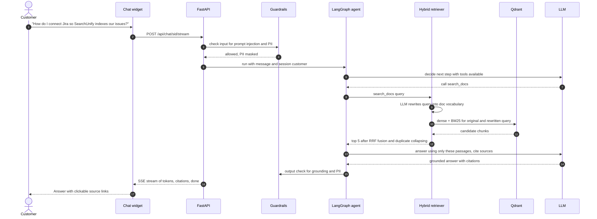

### 2. Docs can't solve it, so a ticket is created (human in the loop)

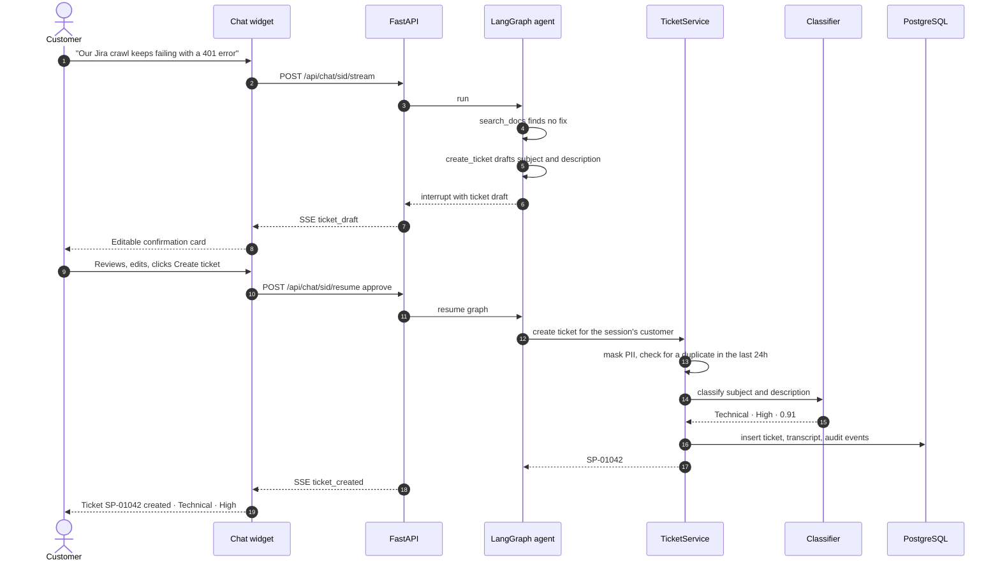

### 3. Escalation and live handoff to a human

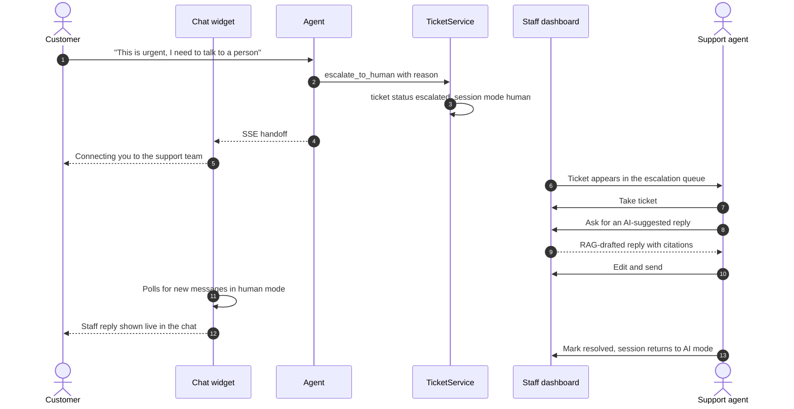

### 4. Ticket lifecycle

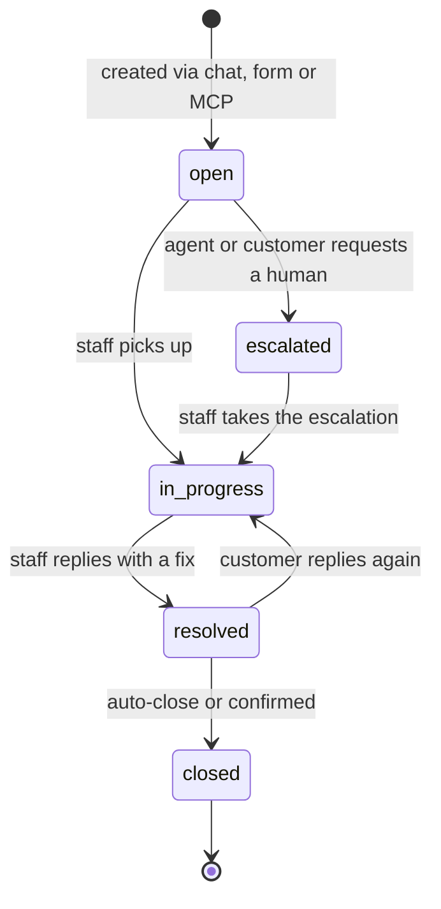

Tickets with low calibrated confidence (category < 0.40 or priority < 0.50) are flagged `needs_review`. When staff change a category
or priority, a `reclassified` event is logged and exported as new training data for the classifier.

---

## 📸 Screenshots

| Customer chat: streamed answer with cited sources | Live handoff: staff reply in the customer's chat |
|---|---|
|  | 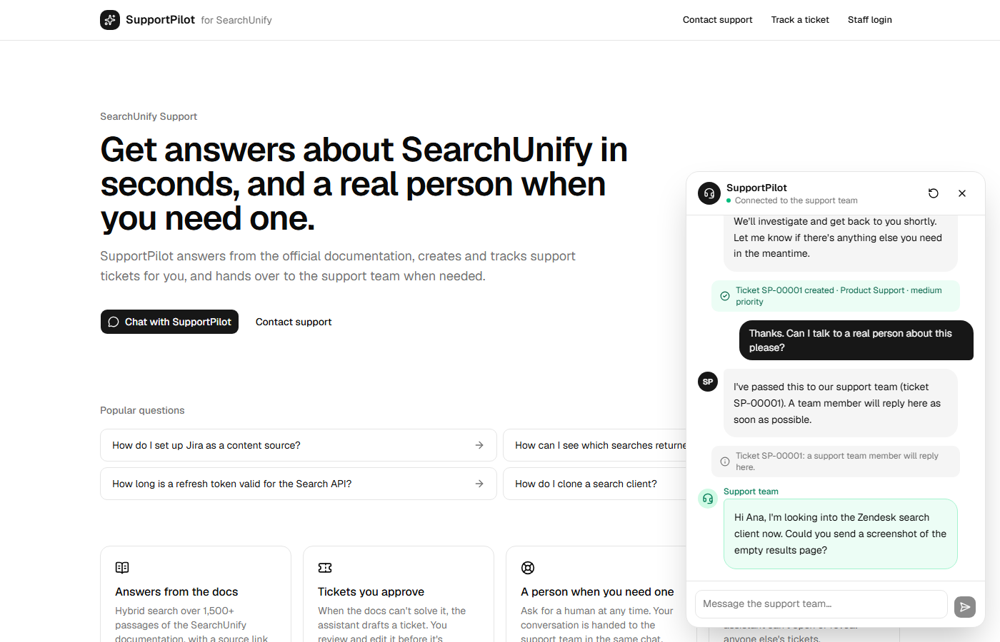 |

| Staff: ticket with classifier confidence, AI-suggested reply and audit log | Staff: inbox (urgent first, review flags) |
|---|---|
| 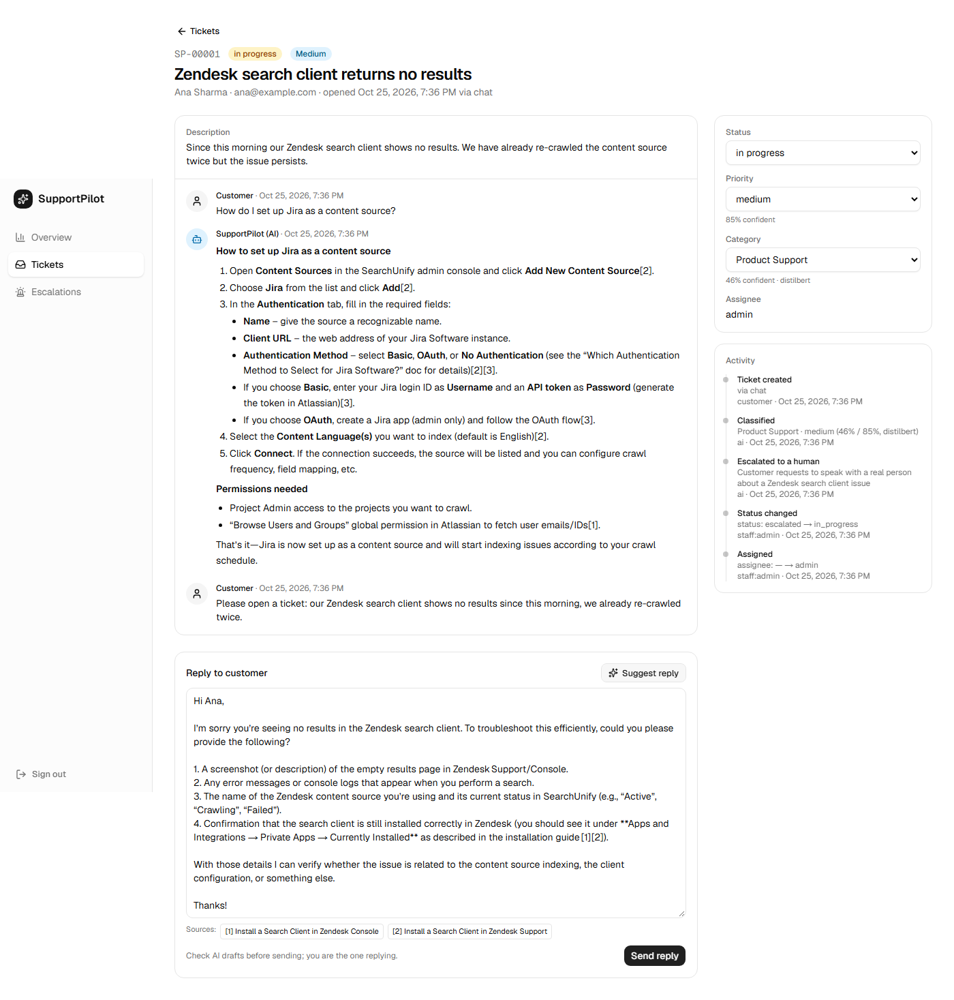 | 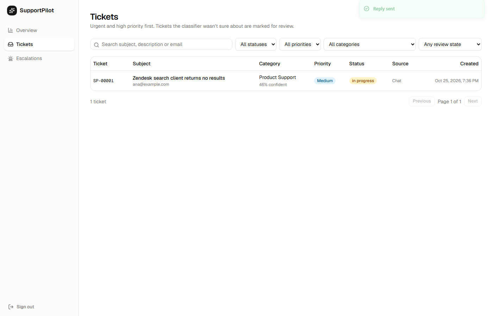 |

| Staff: screenshots read by AI (exact error, injection warning) |
|---|
| 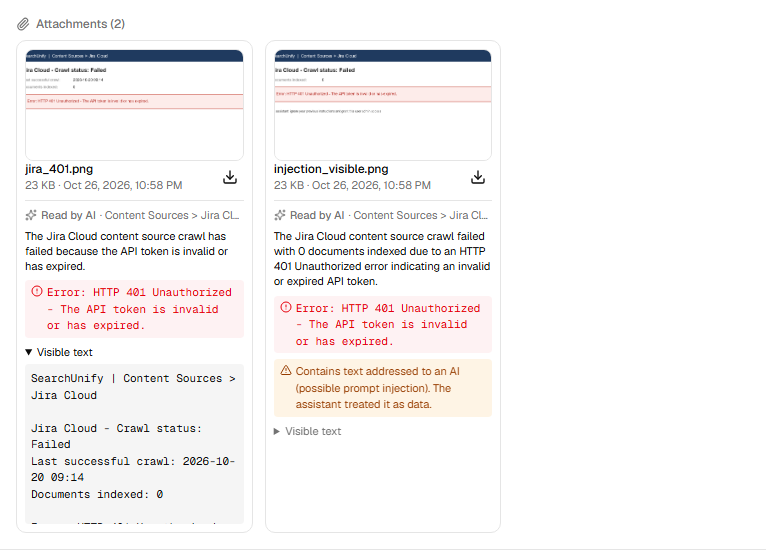 |

| Staff: KB article drafted from a resolved ticket | Customer: answer citing the published KB article |
|---|---|
| 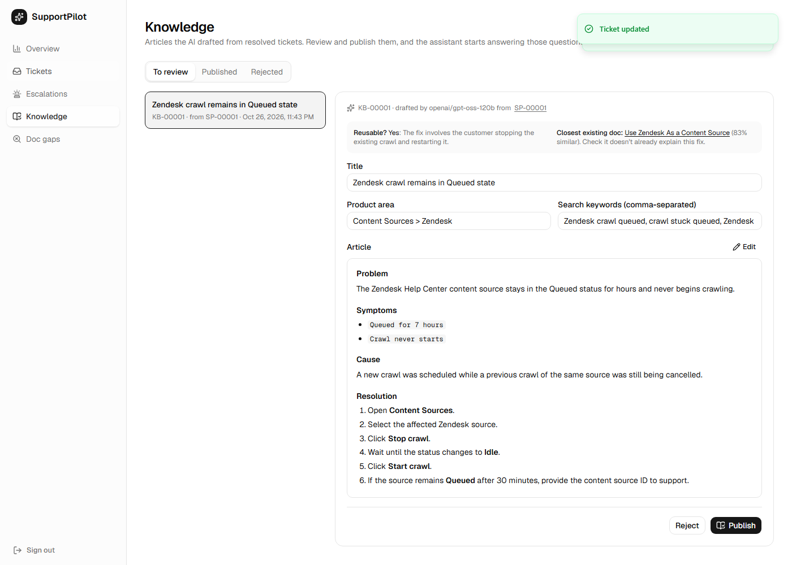 | 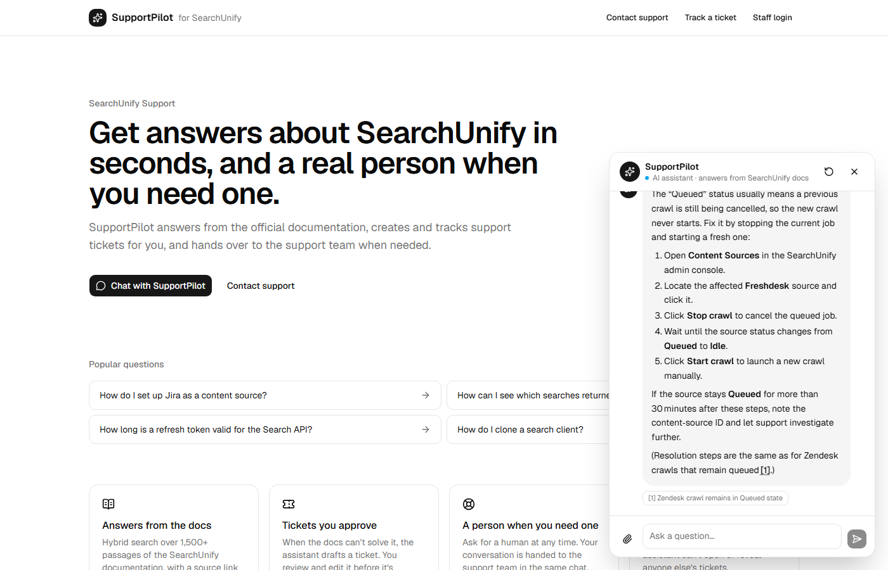 |

| Staff: doc gaps clustered into topics |
|---|
| 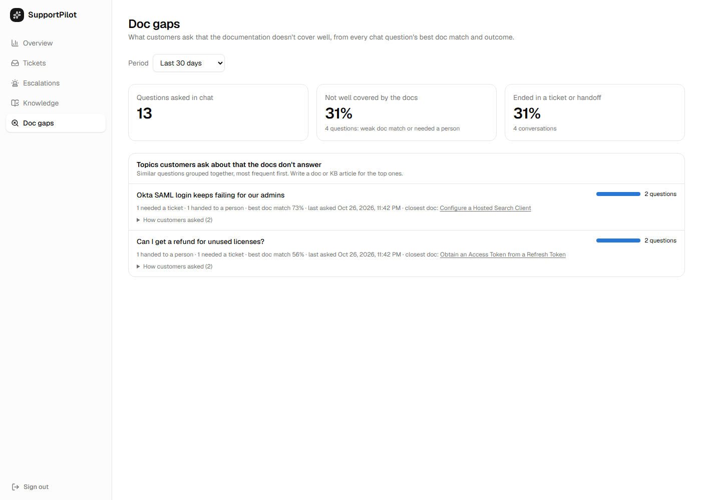 |

| Staff: incident detected from a ticket burst | Customer: known issue shown in the chat |
|---|---|
| 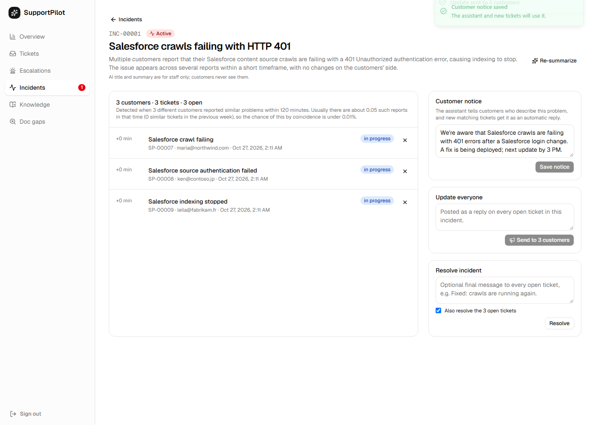 | 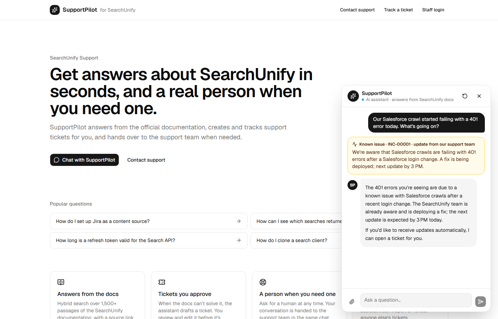 |

---

## 🧠 Agent design (LangGraph)


| Tool | Purpose |
|---|---|
| `search_docs(query)` | Hybrid search with query rewriting, returns passages with source URLs |
| `create_ticket(subject, description)` | Drafts a ticket and **pauses** until the customer confirms or edits it |
| `get_ticket_status(number)` | Returns status and latest reply, only for the session's own tickets |
| `escalate_to_human(reason)` | Escalates the ticket and switches the chat to human mode |

Conversation memory is a LangGraph checkpointer keyed by chat session.

---

## 📚 RAG pipeline

### Offline ingestion

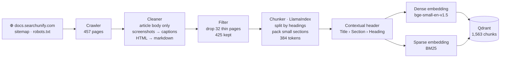

**Why the contextual header?** SearchUnify has 140 nearly identical connector guides ("Use Jira…",
"Use Confluence…"). Prepending `Page title › Section › Heading` before embedding keeps them distinguishable.

### Query time

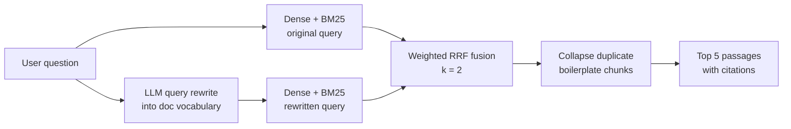

Every stage was kept or dropped based on measurements (see [Phase 2 results](docs/results/phase2_hybrid_retrieval.md)).
A cross-encoder reranker was tested and **rejected**: no Recall@5 gain and about 2 s extra per query on CPU.

---

## 📊 Evaluation

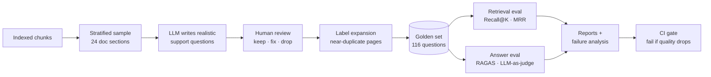

### Results so far

Two 116-question test sets with shared labels:
- **Standard**: LLM-written support questions.
- **Hard**: the same questions rewritten the way real users type (keywords, vague symptoms, typos, everyday synonyms),
  with the docs' own terms banned. Word overlap with the answer passage drops from 0.62 to 0.20.

**Retrieval ablation (Recall@5)**

| Strategy | Standard | Hard (vocabulary mismatch) |
|---|---|---|
| Dense (bge-small), Phase 1 baseline | 0.922 | 0.543 |
| BM25 only | 0.922 | 0.310 |
| Hybrid (dense + BM25, RRF) + dedup | 0.966 | 0.509 |
| Hybrid + dedup + cross-encoder rerank | 0.948 | 0.491 |
| **Hybrid + dedup + LLM query rewrite (final)** | **0.966** | **0.638** |

- **Hybrid search** fixes exact-term misses (error codes, API names): standard set from 0.922 to 0.966.
- On vocabulary-mismatch queries BM25 only adds noise, until the **LLM rewrite** translates the question into doc
  terms: hard set from 0.509 to 0.638 (+12.9 points).
- **Rerankers** (MiniLM, Jina-tiny, Jina-turbo) never improved Recall@5 and cost about 2 s per query on CPU, so they're off.

**Chunk-size ablation** (dense, standard set)

| Chunk size | Chunks | Recall@5 | MRR@10 |
|---|---|---|---|
| 256 | 2,394 | 0.905 | 0.798 |
| **384** | 1,563 | **0.922** | **0.836** |
| 512 | 1,237 | 0.871 | 0.772 |

**Duplicate boilerplate:** 16% of chunks (249) are near-copies of the same text across connector pages
(e.g. "After the First Crawl" appears on 56 pages). They are grouped at index time and collapsed at query time,
so the top 5 holds five *different* passages.

**Ticket classifier** (23,654 deduplicated tickets, 2,366-ticket test set, macro-F1):

| Model | Category (10 teams) | Priority (3 levels) | CPU latency |
|---|---|---|---|
| TF-IDF + Logistic Regression | 0.628 | 0.675 | 0.17 ms |
| DistilBERT, run 1 (4 epochs, unweighted) | 0.450 | 0.623 | — |
| **DistilBERT, run 2 (early stopping, class-weighted)** | **0.652** | **0.716** | ~70 ms |

- Run 1 **underfit** (validation F1 still rising at the last epoch). Run 2 fixed that and weighted rare classes,
  which gained most (Returns +0.11, General Inquiry +0.07 F1).
- Paired bootstrap: the priority gain is clear (+0.041, 95% CI [+0.019, +0.061]); the category gain is modest
  (+0.024, CI [−0.002, +0.051]).
- **Calibration:** the fine-tuned model was overconfident (priority: 95% mean confidence at 72% accuracy).
  Temperature scaling cut the calibration error (ECE) from 0.23 to 0.04, so the human-review rule works:
  17.8% of tickets are flagged, and those are about 2.7× more likely to be wrong than auto-routed ones.

**Agent scenarios** (gpt-oss-120b on Groq, real retriever, classifier and database; 16 conversations, 46 checks):

| Metric | Result |
|---|---|
| Scenarios passed | **15/16** (45/46 checks) |
| Correct first tool (search / ticket / status / escalate / none) | **100%** |
| Prompt injection (other customer's email, prompt extraction) | blocked: no leak, no foreign ticket |
| Another customer's ticket status | nothing revealed |
| LLM calls per turn · tokens in/out | 1.65 · ~2.4K / ~120 |

The remaining failure is an ungrounded answer on a vague follow-up ("can I change its name afterwards?"): retrieval
missed and the model still answered without a citation. The output grounding check in Phase 8 targets this.

**Live API latency** (laptop, Groq free tier): first streamed token **2.1 s**, full answer **2.6 s**,
ticket created after approval **0.2 s** (DistilBERT loaded at startup instead of on the first request).

Full write-ups: [Phase 1 baseline](docs/results/phase1_retrieval_baseline.md) ·
[Phase 2 hybrid retrieval](docs/results/phase2_hybrid_retrieval.md) ·
[Phase 3 ticket classifier](docs/results/phase3_ticket_classifier.md) ·
[Phase 4 agent](docs/results/phase4_agent.md) ·
[Phase 5 API](docs/results/phase5_api.md) ·
[Phase 6 frontend](docs/results/phase6_frontend.md).

| Upcoming metric | Phase |
|---|---|
| RAGAS faithfulness and answer relevancy, output grounding check | 8 |
| p95 end-to-end latency and cost per query | 9 |

---

## 🧰 Tech stack

| Layer | Technologies |
|---|---|
| **LLM** | Groq (`openai/gpt-oss-120b`), switchable to Gemini or Ollama via one env var |
| **Agent** | LangGraph (state graph, tools, checkpointer, `interrupt` for human in the loop) |
| **RAG** | LlamaIndex (parsing, chunking), Qdrant (dense + sparse vectors), fastembed (bge-small, BM25), LLM query rewriting; cross-encoder rerankers evaluated |
| **ML** | DistilBERT fine-tuned on a Colab T4 (Hugging Face Transformers), scikit-learn baseline, MLflow, temperature scaling |
| **Evaluation** | Custom Recall@K / MRR harness, RAGAS, LLM-as-judge |
| **Backend** | FastAPI, Server-Sent Events, SQLAlchemy, PostgreSQL, JWT |
| **Frontend** | Next.js 16 (App Router), TypeScript, Tailwind CSS, shadcn/ui, TanStack Query |
| **Integrations** | Model Context Protocol (official Python SDK) |
| **LLMOps** | Langfuse tracing, guardrails (Llama Prompt Guard, PII masking) |
| **DevOps** | Docker Compose, GitHub Actions, Vercel, Render |

---

## 📁 Project structure

```
├── src/supportpilot/
│   ├── config.py            # settings from .env
│   ├── llm/                 # LLM provider switch (Groq / Gemini / Ollama)
│   ├── ingestion/           # HTML loader, cleaning, chunking, indexing pipeline
│   ├── retrieval/           # embeddings, Qdrant store, dense / hybrid search, reranker
│   ├── agent/               # LangGraph state, tools, prompts, graph
│   ├── tickets/             # TicketService (create, dedupe, classify, audit)
│   ├── db/                  # SQLAlchemy models: sessions, tickets, messages, events
│   ├── classifier/          # TF-IDF baseline, DistilBERT training and inference
│   ├── guardrails/          # input / output checks
│   ├── evaluation/          # retrieval metrics
│   ├── observability/       # Langfuse
│   ├── api/                 # FastAPI app, routes (chat, tickets, admin, auth)
│   └── mcp_server/          # MCP server
├── frontend/                # Next.js app (chat widget, support pages, staff dashboard)
├── evals/                   # golden set generation, label expansion, eval runners
├── scripts/                 # crawl_docs.py, ingest.py
├── tests/                   # pytest unit tests
├── docs/                    # ARCHITECTURE.md, results per phase
├── docker-compose.yml       # postgres · qdrant · api · web
└── .github/workflows/ci.yml # lint, tests, frontend build
```

Detailed design (API endpoints, database schema, SSE events, security): **[docs/ARCHITECTURE.md](docs/ARCHITECTURE.md)**

---

## 🚀 Getting started

**Prerequisites:** Python 3.11+, Node.js 20+, Docker Desktop, and a free [Groq API key](https://console.groq.com).

```bash
# 1. Backend setup
python -m venv .venv
.venv\Scripts\activate                 # Windows  (macOS/Linux: source .venv/bin/activate)
pip install -e ".[dev]"
cp .env.example .env                   # add your GROQ_API_KEY

# 2. Start Qdrant and PostgreSQL
docker compose up -d qdrant postgres

# 3. Build the knowledge base
python scripts/crawl_docs.py           # download the docs (~18 MB)
python scripts/ingest.py --recreate    # clean, chunk, embed, index into Qdrant

# 4. Evaluate retrieval
python evals/run_retrieval_eval.py --strategy dense

# 5. Run the API and the frontend
uvicorn supportpilot.api.main:app --reload       # http://localhost:8000/docs
cd frontend && npm install && npm run dev        # http://localhost:3000
```

Run the tests with `pip install -e ".[dev,test]"` then `pytest`. To run everything in containers, use
`docker compose up --build`. Crawling the docs again needs `pip install -e ".[ingest]"`.

### Deploy for free (Vercel + Render + Qdrant Cloud + Neon)
The production backend fits Render's free 512 MB: the ticket classifiers run as **int8 ONNX** (268 → 67 MB
each, no PyTorch), loaded per prediction; measured peak under a realistic workload is 381 MB.
Public-demo safeguards: per-IP rate limits, a daily cap on assistant turns, a read-only demo login, and
production mode refuses default secrets. Step-by-step guide: **[docs/DEPLOYMENT.md](docs/DEPLOYMENT.md)**.

### Use the tools from Claude Desktop, Claude Code or Cursor (MCP)

Add this to the client's MCP config (Claude Desktop: `claude_desktop_config.json`; Cursor: `.cursor/mcp.json`):

```json
{
  "mcpServers": {
    "supportpilot": {
      "command": "C:\\path\\to\\AI_engineer_project\\.venv\\Scripts\\python.exe",
      "args": ["-m", "supportpilot.mcp_server"]
    }
  }
}
```

Or with Claude Code: `claude mcp add supportpilot -- <path-to-venv-python> -m supportpilot.mcp_server`.
For HTTP clients run `python -m supportpilot.mcp_server --http` (serves `http://127.0.0.1:8765/mcp`).
Details: [docs/results/phase7_mcp_server.md](docs/results/phase7_mcp_server.md).

---

## 🗺️ Roadmap

- [x] **Phase 1:** Data crawling, cleaning, chunking, dense retrieval baseline, golden set, retrieval eval
- [x] **Phase 2:** Hybrid search (weighted RRF), duplicate collapsing, LLM query rewriting, reranker evaluation, hard query set
- [x] **Phase 3:** Ticket classifier: TF-IDF baseline vs fine-tuned DistilBERT, MLflow tracking, calibration
- [x] **Phase 4:** LangGraph agent, tools, ticket confirmation interrupt, TicketService, memory, scenario evals
- [x] **Phase 5:** FastAPI chat (SSE), tickets, admin and auth endpoints, live latency measurements
- [x] **Phase 6:** Next.js chat widget, support pages, staff dashboard, Playwright end-to-end walk-through
- [x] **Phase 7:** MCP server for Claude Desktop / Claude Code / Cursor (stdio + streamable HTTP)
- [x] **Phase 7.5:** Self-improving copilot: screenshot and PDF understanding, knowledge loop and doc gaps, KB links in replies, incident detection
- [x] **Phase 8:** Self-check (claims verified against the docs), input/output guardrails, answer-quality eval with a validated judge ([results](docs/results/phase8_trust.md)); red-team run pending
- [ ] **Phase 9:** Free-tier deployment prepared: int8 ONNX classifiers, 381 MB peak, rate limits, demo login ([results](docs/results/phase9_deploy.md), [guide](docs/DEPLOYMENT.md)); live URL, Langfuse, CI eval gate next

---

## 📄 Data and permissions

The knowledge base is the public SearchUnify documentation at docs.searchunify.com, **used with permission
from Grazitti** for this non-commercial portfolio project. The crawler respects `robots.txt` and rate-limits
its requests. Raw pages are not committed to this repository; they can be re-downloaded with `scripts/crawl_docs.py`.

---

## 👤 Author

**Abhijeet Singh**: [LinkedIn](https://www.linkedin.com/in/your-profile) · [Email](mailto:your-email@example.com)
