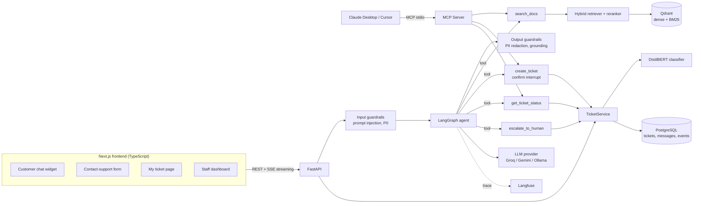
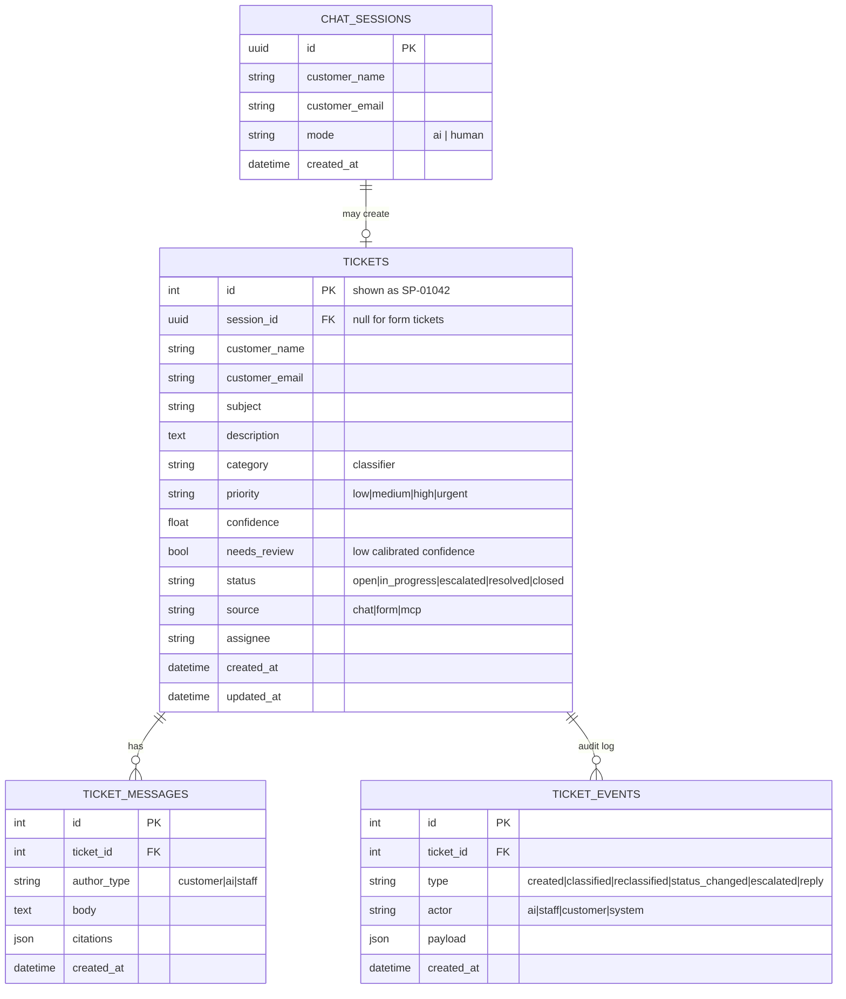
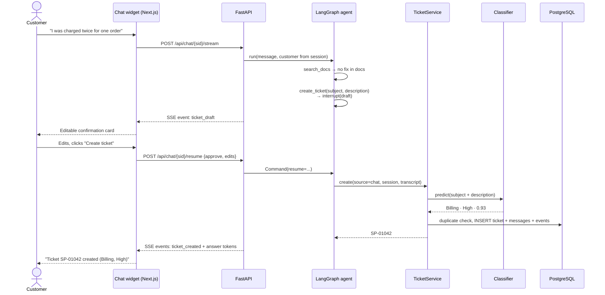
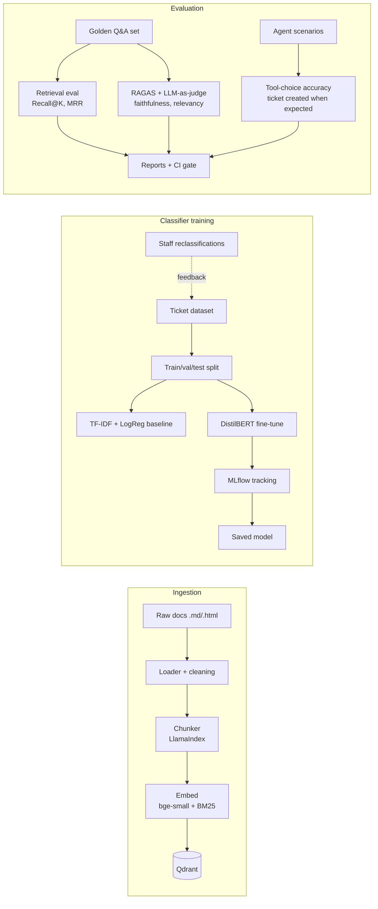

# SupportPilot — Architecture

Agentic RAG customer-support platform. Customers chat with an AI assistant that answers from
product documentation, creates and tracks support tickets, and hands off to human staff.
Staff work tickets in a dashboard with AI-classified priority and AI-drafted replies.
The system is evaluated, guarded, traced and deployed like a production service.

---

## 1. High-level system



Every way of creating or changing a ticket (chat agent, contact form, staff dashboard, MCP)
goes through **one `TicketService`**. Classification, duplicate checks and audit events
therefore happen in one place.

---

## 2. Frontend (Next.js)

**Stack:** Next.js (App Router) · TypeScript · Tailwind CSS · shadcn/ui · TanStack Query ·
react-markdown · Recharts. Next.js `rewrites` proxy `/api/*` to FastAPI, so the browser
never needs CORS.

### Customer side
| Route | Purpose |
|---|---|
| `/` | Product landing page with the floating **chat widget** |
| `/support/new` | Contact-support form (creates a ticket without chatting) |
| `/support/tickets` | Look up a ticket by number + email |
| `/support/tickets/[number]` | Ticket status, staff replies, add a reply |

**Chat widget features:** pre-chat form (name + email), token streaming, a "Searching docs…"
status while tools run, clickable source citations, an editable **ticket confirmation card**,
and a live **handoff mode** after escalation, in which staff replies appear in the chat.

### Staff side (login required)
| Route | Purpose |
|---|---|
| `/login` | Staff login (JWT) |
| `/dashboard` | Metrics: tickets by category/priority, AI resolution rate, eval scores |
| `/dashboard/tickets` | Inbox with filters (status, priority, category, needs-review) |
| `/dashboard/tickets/[id]` | Conversation, classifier label + confidence, override, **AI suggested reply**, status changes |
| `/dashboard/escalations` | Queue of escalated tickets waiting for a human to take them |

### Layout
```
frontend/
├── app/
│   ├── page.tsx                        # landing + chat widget
│   ├── support/new/page.tsx
│   ├── support/tickets/page.tsx
│   ├── support/tickets/[number]/page.tsx
│   ├── login/page.tsx
│   └── dashboard/
│       ├── layout.tsx                  # auth guard + sidebar
│       ├── page.tsx
│       ├── tickets/page.tsx
│       ├── tickets/[id]/page.tsx
│       └── escalations/page.tsx
├── components/
│   ├── chat/      # ChatWidget, MessageBubble, Citations, TicketDraftCard, ToolStatus
│   ├── tickets/   # TicketTable, Filters, PriorityBadge, SuggestedReply, Timeline
│   └── ui/        # shadcn/ui primitives
├── lib/           # api.ts (typed client), sse.ts (stream parser), types.ts
└── next.config.ts # /api/* → FastAPI rewrite
```

---

## 3. Ticket system: where and how tickets are created

### 3.1 Where tickets live
In **PostgreSQL** (Docker locally, Neon/Supabase free tier in the cloud), accessed through
SQLAlchemy. Unit tests use SQLite.



### 3.2 Three ways to create a ticket, one code path

| Source | Trigger | Customer identity |
|---|---|---|
| **Chat agent** | Docs can't solve the issue, or the customer asks for support | From the chat session (pre-chat form) |
| **Contact form** | Customer submits `/support/new` | From the form |
| **MCP** | An MCP client calls `create_ticket` | Passed as a tool argument |

`TicketService.create()` runs the same steps for all three:
1. **Validate** the input and mask PII in the stored description (card numbers etc.).
2. **Duplicate check**: if the same email has an open ticket from the last 24h with an
   embedding similarity above 0.85, add a message to that ticket instead of creating a new one.
3. **Classify** with DistilBERT to get a category, priority and confidence. Rule overrides
   apply on top (e.g. "security" or "data breach" → `urgent`). If calibrated confidence is low (category < 0.40 or priority < 0.50),
   set `needs_review`.
4. **Insert** the ticket, then the chat transcript as `ticket_messages` (chat source),
   then the `created` and `classified` events, all in one transaction.
5. **Return** the ticket number, e.g. `SP-01042`.

### 3.3 Chat flow: creating a ticket with human-in-the-loop confirmation



**Security design:** the agent never chooses the customer's email. The tools read it from the
session (LangGraph `InjectedState`), so a prompt-injected agent cannot create tickets for
other people or read their tickets. `get_ticket_status` only returns tickets owned by the
session's email.

### 3.4 Escalation and live handoff
1. The agent calls `escalate_to_human(reason)`. This happens for refunds, legal or security
   issues, angry customers, or when the customer asks for a person.
2. The ticket's status becomes `escalated` (a ticket is created first if none exists), the
   session's `mode` becomes `human`, and the agent stops replying.
3. The ticket appears in `/dashboard/escalations`. A staff member clicks **Take**, which sets
   the assignee and status `in_progress`.
4. Staff replies are saved as `ticket_messages`. The chat widget in `human` mode polls
   `GET /api/chat/{sid}/messages` every few seconds, so replies appear live.
5. When staff **resolve** the ticket, the session returns to `ai` mode.

### 3.5 Staff-side AI (human in the loop)
- **Suggested reply:** `POST /api/admin/tickets/{id}/suggest-reply` uses RAG over the docs plus
  the ticket history to draft a cited reply. Staff edit it and send it. The system never sends
  it on its own.
- **Reclassification feedback:** when staff change a category or priority, a `reclassified`
  event is logged. `scripts/export_feedback.py` turns these events into new training data for
  the classifier. This is a real ML feedback loop.

---

## 4. Backend API (FastAPI, prefix `/api`)

| Method & path | Auth | Purpose |
|---|---|---|
| `POST /sessions` | — | Start a chat session `{name, email}` and get a `session_id` |
| `POST /chat/{sid}/stream` | session | Send a message; **SSE** stream of agent events |
| `POST /chat/{sid}/resume` | session | Approve, edit or cancel a ticket draft (resumes the interrupt) |
| `GET /chat/{sid}/history` | session | Conversation so far, mode, ticket number, pending draft (page reloads) |
| `GET /chat/{sid}/messages?after=` | session | Poll for staff replies in handoff mode |
| `POST /tickets` | — | Create a ticket from the contact form |
| `POST /tickets/lookup` | number + email | Customer ticket view |
| `POST /tickets/{number}/replies` | number + email | Customer reply |
| `POST /auth/login` | — | Staff login and JWT |
| `GET /admin/tickets` | staff | Inbox with filters + search |
| `GET /admin/tickets/{id}` | staff | Ticket detail, messages, events |
| `PATCH /admin/tickets/{id}` | staff | Status, priority, category, assignee |
| `POST /admin/tickets/{id}/replies` | staff | Staff reply |
| `POST /admin/tickets/{id}/suggest-reply` | staff | AI-drafted reply with citations |
| `GET /admin/escalations` | staff | Escalation queue |
| `POST /admin/escalations/{id}/take` | staff | Take an escalated ticket |
| `GET /admin/metrics` | staff | Dashboard aggregates |
| `POST /classify` | staff | Classifier playground |
| `GET /health` | — | Liveness |

**SSE event types** sent by `/chat/.../stream`: `token`, `tool_start`, `tool_end`,
`citations`, `ticket_draft`, `ticket_created`, `handoff`, `stored` (human mode), `blocked`, `done`, `error`.

---

## 5. Agent design (LangGraph)

```
START → guard_input → agent ──tool calls──► tools ──► agent … ──► guard_output → END
                        │                     │
                        │                     └─ create_ticket → interrupt(ticket_draft)
                        └─ max steps / no tool calls ──────────────────► guard_output
```

| Tool | What it does | Notes |
|---|---|---|
| `search_docs(query)` | Hybrid search + rerank, returns passages with source ids | Citations go to the UI |
| `create_ticket(subject, description)` | Drafts a ticket, **interrupts for customer confirmation**, then calls `TicketService` | Email injected from the session |
| `get_ticket_status(number)` | Status + latest staff reply | Scoped to the session's email |
| `escalate_to_human(reason)` | Escalates and switches the session to human mode | Ends the agent's turn |

- **Memory:** LangGraph checkpointer keyed by `thread_id = session_id` (Postgres saver in
  Docker, SQLite saver for local runs and tests).
- **Loop guard:** at most `MAX_AGENT_STEPS` tool rounds, then the agent gives a graceful fallback
  answer.

---

## 6. Offline pipelines



---

## 7. Component decisions

| Component | Choice | Why |
|---|---|---|
| Frontend | **Next.js + TypeScript + Tailwind + shadcn/ui** | Modern production stack; one app for customers and staff |
| Streaming | **SSE** (FastAPI → `fetch` stream) | Token streaming + tool events, simpler than WebSockets |
| Orchestration | **LangGraph** | State graph, checkpoints, `interrupt()` for human in the loop |
| Ingestion / chunking | **LlamaIndex** node parsers | Markdown-aware splitting, metadata for citations |
| Vector DB | **Qdrant** | Dense + sparse vectors → hybrid search in one query |
| Embeddings | **bge-small-en-v1.5** (fastembed) | Runs on CPU, strong quality |
| Sparse + fusion | **BM25** + **Reciprocal Rank Fusion** | Catches exact terms (error codes, plan names) |
| Reranker | **ms-marco-MiniLM-L-6-v2** cross-encoder | Large precision gain for low cost |
| LLM | **Groq** (default), Gemini, Ollama | Free/fast; switch with `LLM_PROVIDER` |
| Classifier | **DistilBERT** vs TF-IDF + LogReg | Baseline, metrics, tracking, feedback loop |
| Experiment tracking | **MLflow** | Industry standard |
| App database | **PostgreSQL** + SQLAlchemy | Real relational store; SQLite in tests |
| Eval | **RAGAS** + Recall@K/MRR + LLM-as-judge + agent scenarios | Measured quality, CI gate |
| Guardrails | Rules + LLM check, PII masking | Prompt-injection and PII defence |
| Observability | **Langfuse** | Traces, latency, cost per query |
| MCP | Official `mcp` SDK (FastMCP) | Exposes tools to any MCP client |
| Packaging / deploy | **Docker Compose**; Vercel (web) + Render (API) + Neon + Qdrant Cloud | All free tiers |
| CI/CD | **GitHub Actions** | Lint, tests, frontend build, eval gate |

---

## 8. Repository layout

```
AI_engineer_project/
├── src/supportpilot/
│   ├── config.py               # settings from .env
│   ├── llm/provider.py         # get_llm(): Groq / Gemini / Ollama
│   ├── db/                     # engine/session + SQLAlchemy models (sessions, tickets, messages, events)
│   ├── ingestion/              # load → clean → chunk → index
│   ├── retrieval/              # Qdrant store, hybrid search, reranker
│   ├── tickets/                # TicketService (create, dedupe, classify, events) + schemas
│   ├── agent/                  # LangGraph state, tools, prompts, graph
│   ├── classifier/             # baseline + DistilBERT training, inference
│   ├── guardrails/             # input/output checks
│   ├── observability/          # Langfuse setup
│   ├── api/                    # FastAPI app, routes (chat, tickets, admin, auth), schemas
│   └── mcp_server/             # MCP server
├── frontend/                   # Next.js app (Section 2)
├── evals/                      # golden datasets, retrieval / RAGAS / agent evals
├── scripts/                    # ingest, seed DB, export feedback
├── tests/
├── data/                       # raw + processed data (git-ignored)
├── docs/ARCHITECTURE.md
├── docker-compose.yml          # postgres + qdrant + api + web
└── .github/workflows/ci.yml
```

---

## 9. Build phases

| Phase | Scope | Resume metric produced |
|---|---|---|
| 1 | Docs data + ingestion + dense retrieval baseline + retrieval eval | Recall@5 (baseline) |
| 2 | Hybrid search + reranker | Recall@5 (improved) |
| 3 | Classifier: baseline + DistilBERT + MLflow | F1 vs baseline |
| 4 | Database schema + TicketService + LangGraph agent, tools, confirm interrupt, memory | — |
| 5 | FastAPI: SSE chat, ticket, admin and auth routes | — |
| 6 | **Next.js frontend**: chat widget, support pages, staff dashboard | Live demo |
| 7 | MCP server | — |
| 8 | RAGAS / LLM-as-judge / agent evals + guardrails | Faithfulness, tool accuracy |
| 9 | Langfuse + Docker Compose + CI/CD + cloud deploy | p95 latency, $/query, live URL |
