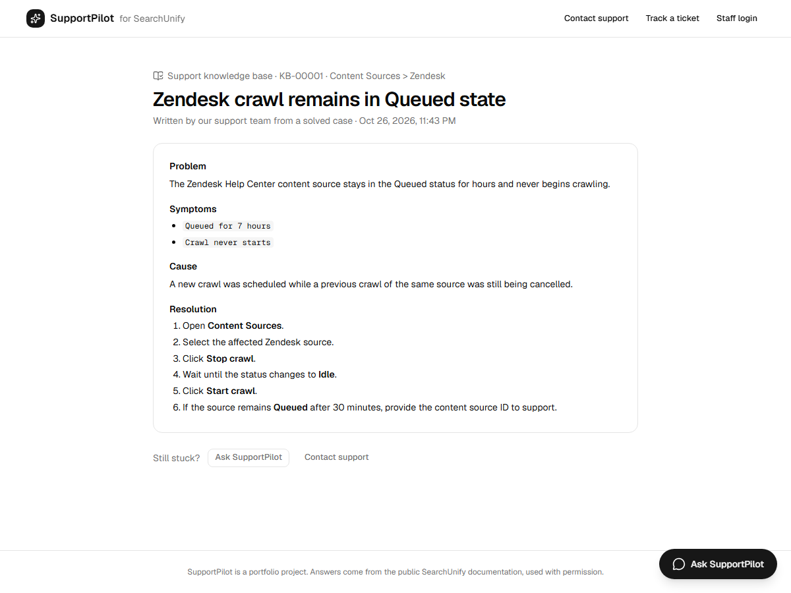
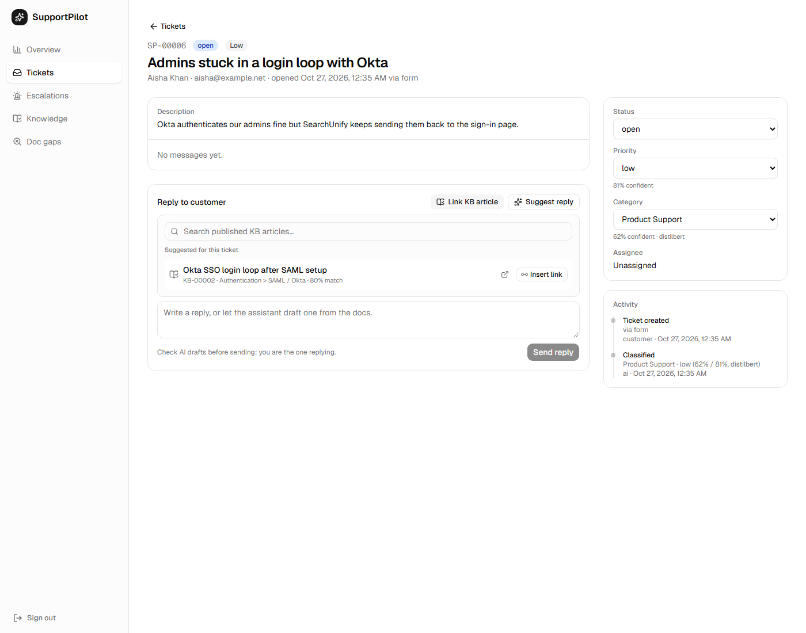

# Phase 7.5b: Knowledge loop (the assistant learns from resolved tickets)

Support teams solve problems every day that the documentation doesn't cover, and that knowledge stays
inside individual tickets. This feature closes the loop:

```
customer question ─► assistant (docs + KB) ─► answered
        │                                  └► ticket / handoff ─► staff reply ─► resolved
        │                                                                         │
        ▼                                                                         ▼
  question log (coverage, outcome)                          LLM drafts a KB article (background)
        │                                                    grounded in the conversation, anonymised,
        ▼                                                    "who fixed it?" -> reusable or not
  Doc gaps page: uncovered questions                                              │
  clustered into topics                                     staff review: edit / publish / reject
                                                                                  │
                                    published ─► chunked + embedded (dense + BM25) into the same
                                                 Qdrant collection as the docs ─► cited in answers,
                                                 public page /support/kb/KB-00001
```

## What was built
| Part | Details |
|---|---|
| **Drafting** | On resolve (FastAPI background task, after commit) or on demand. `gpt-oss-120b` in JSON mode writes title, problem, symptoms, cause, resolution, product area, keywords. Only facts from the conversation are allowed ("Not stated." otherwise). |
| **Privacy** | Input is already PII-masked; the output is masked again and the customer's name, email, email domain, company and ticket numbers are removed. |
| **Reusability** | The LLM reports **who performed the fix** (`customer` vs `support_team`). Articles about refunds, credits or backend fixes are flagged "probably not reusable". |
| **Coverage hint** | Each draft shows the closest existing doc and its similarity, so staff can spot duplicates of the docs. |
| **Review** | Dashboard *Knowledge* page: edit with markdown preview, publish, unpublish, reject; edits to published articles are re-indexed. The ticket page shows the article learned from it (or a "Draft KB article" button). |
| **Indexing** | Same chunker, contextual headers and dense + BM25 vectors as the docs (`doc_type=kb`, `section=Knowledge-Base`), so hybrid search ranks articles alongside the docs with no retrieval changes. The agent sees them as "Support KB article" passages. |
| **Public page** | `/support/kb/KB-00001`, the target of KB citations in the chat. Drafts and rejected articles return 404. |
| **Doc gaps** | Every chat question (4+ words) is logged with its best dense match (cosine) and outcome (answered / ticket / handoff). Gaps = coverage below threshold, or the chat needed a ticket or a person. Gaps are clustered (agglomerative, cosine, average linkage) into topics on the *Doc gaps* page. |
| **Schema** | Two new tables (`kb_articles`, `question_logs`), created automatically at startup. |

## Calibration (both thresholds measured, not guessed)
**Coverage threshold.** Best-chunk cosine (bge-small) for 232 answerable golden questions vs. 20 off-topic
support questions (refunds, contracts, unrelated products):

| Threshold | Standard questions flagged | Paraphrased (hard) questions flagged | Off-topic caught |
|---|---|---|---|
| 0.80 (first guess) | 59.5% of all answerable | | 100% |
| 0.70 | 0.9% | 45.7% | 95% |
| **0.66 (chosen)** | **0.9%** | **10.3%** | **80% (16/20)** |
| 0.64 | 0% | 5.2% | lower |

The first guess would have called most answerable questions "gaps". Questions that end in a ticket or a
handoff count as gaps regardless of coverage, which catches much of the rest.

**Cluster distance.** 25 paraphrased questions in 6 topics (SSO, queued crawls, refunds, Slack, exports,
mobile SDK): distance 0.32–0.35 recovers all 6 topics (adjusted Rand index 1.00); 0.30 splits one, 0.38
merges two. **0.35** was chosen after a real pair ("refund for unused licenses" / "money back for seats we
never used", distance 0.336) was split at 0.32 in the browser test. Unrelated topics sit around 0.5.
Small calibration sets: treat these as starting values to revisit with real traffic.

## Evaluation: before vs. after publishing (`python evals/run_kb_loop_eval.py`)
Six synthetic support cases whose fixes are not in the public docs (a crawl stuck in Queued, facet counts
after a Salesforce field rename, an Okta SAML redirect loop, an analytics export timeout, a search client
CORS error, and a one-off refund). Each: ticket + support reply → real LLM draft → the real agent answers a
**paraphrased** question from another customer (often about a different product, e.g. Freshdesk instead
of Zendesk) before and after the article is published.

| Metric | Result |
|---|---|
| Articles containing the support team's fix (grounded) | **5/5** |
| Articles free of the customer's name, email, company | **6/6** |
| Reusability flag correct (refund flagged as not reusable) | **6/6** |
| Published article in the top 5 search results | **5/5** (rank 1 in 4, rank 3 in 1) |
| Answer contains the specific fix: **before → after** | **1/5 → 5/5** |
| Answer cites the KB article after publishing | **5/5** |

Notes, so the numbers aren't over-read:
- **Before** answers were reasonable doc-based answers on related topics (e.g. the real CORS setting in
  the docs), not nonsense; they just didn't contain the support team's specific fix. The one "before" hit
  (facet rename) was partly answerable from the docs, so that case wasn't a pure gap.
- **Scoring is keyword-based** (every group of fix terms must appear). Two scorer bugs were found and fixed
  before reporting: gpt-oss writes narrow no-break spaces and non-breaking hyphens ("30 days" didn't
  match), and the leak check matched "tom" inside "custom". The saved answers were re-scored; they weren't
  regenerated.
- **Reusability** was 5/6 in the first run (the refund was called reusable). Asking a yes/no "does this
  generalize?" question invited optimism; asking **who performed the fix** (a fact in the conversation) fixed
  it. The drafting stage was re-run with the new prompt (`--drafts-only`, `evals/reports/kb_loop_drafts.json`);
  the before/after answers come from the first full run (`evals/reports/kb_loop_eval.json`) to stay within
  the Groq free tier's 200K tokens/day.
- Five reusable cases is a small sample: this shows the loop works end to end, not a production accuracy.
- In 0/5 "before" cases did the assistant offer a ticket even though it lacked the fix; it answered with
  related doc content instead. Knowing when it doesn't know is the Phase 8 grounding/abstention work.

## End-to-end in the browser (real LLM, isolated server)
1. Staff replied to a "Zendesk crawl stuck in Queued" ticket and set it to *resolved*.
2. The AI draft appeared on the ticket page **3.4 s** later; staff opened it on the *Knowledge* page and
   published it.
3. A different customer asked *"Our **Freshdesk** content source has said Queued since yesterday and never
   crawls. What should I do?"*. The assistant answered with Stop crawl → wait for Idle → Start crawl → 30
   minutes, citing the KB article, and the citation opened the public article page.
4. First run, the assistant said "see the resolved Zendesk-source case", which mentions another customer's
   ticket. The passage label was changed to "Support KB article" and the prompt told not to mention other
   customers; re-run: "Resolution steps are the same as for Zendesk crawls that remain queued [1]".

| Staff review | Customer answer citing the KB |
|---|---|
|  |  |

| Doc gaps (10 of the 13 questions were seeded through the real logging function) | Public KB page |
|---|---|
|  |  |

## Agents link articles in their replies
The reply box on a ticket has a **Link KB article** panel:
- **Suggested for this ticket:** published articles by dense similarity to the ticket's subject and
  description (KB chunks only); matches under 60% are hidden so agents aren't shown unrelated articles.
- **Search:** typed queries show every match with its similarity.
- **Insert link** puts `[Title](public URL)` at the cursor; customers see it as a clickable link on their
  ticket page and in the chat (staff replies render markdown).
- Each staff reply containing KB links logs a `kb_linked` event, so the Knowledge page shows
  "Linked in N replies" per article (which articles actually help agents).
- AI-suggested replies now end with a linked **Sources** list: before, customers saw bare `[1]` markers
  because the source chips are only shown to staff.

Browser check on a copy of the live database (no writes to the shared search index): for a new ticket
"Admins stuck in a login loop with Okta", the panel suggested only the Okta article (80% match), and the
unrelated export article stayed hidden. Searching "export times out" found the export article (81%, Okta
54%). The inserted link was clickable on the customer's ticket page, the activity log showed "KB article
linked", and the Knowledge page showed "Linked in 1 reply".



## Tests
11 new tests (`tests/test_knowledge.py`; LLM, Qdrant and embeddings faked; conftest blocks real calls):
customer identifiers scrubbed; resolving drafts an anonymised article in the background (once, never
twice); no draft without a staff reply; a drafting failure doesn't break resolving; review → edit → publish
→ public page → re-index on edit → reject removes it from the index; staff-only access; indexing uses the
docs pipeline (payload, URL, delete-before-upsert); KB passages labelled for the agent; chat questions
logged with outcomes (and "thanks" skipped); gap clustering and stats; support-team fixes flagged as not
reusable; agents find and link published articles (only published, best chunk score, KB-only filter,
weak suggestions hidden, typed search, link tracked, usage count). Full suite: **68 passed**.
